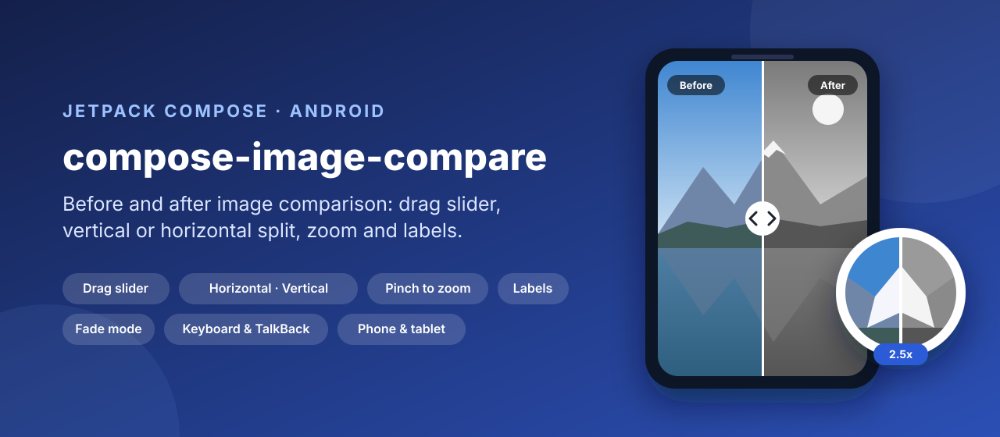
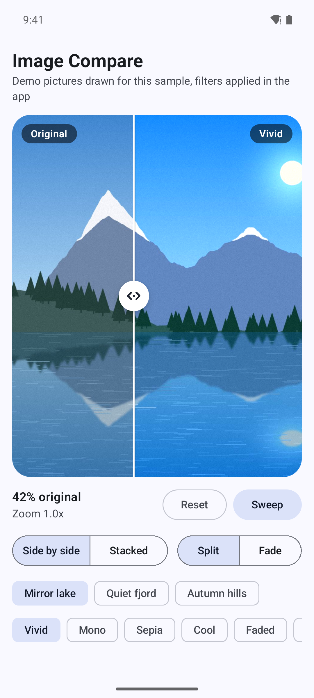
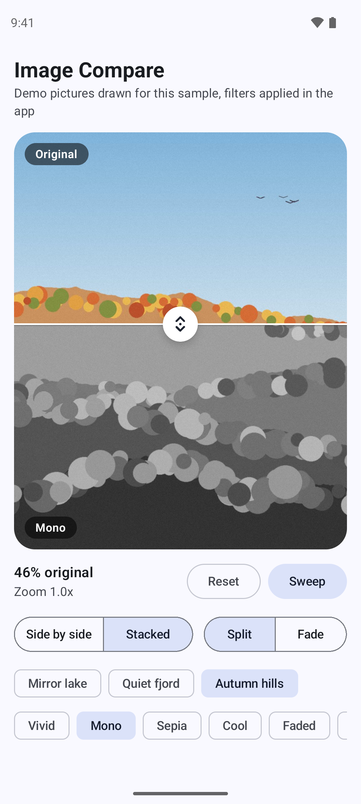
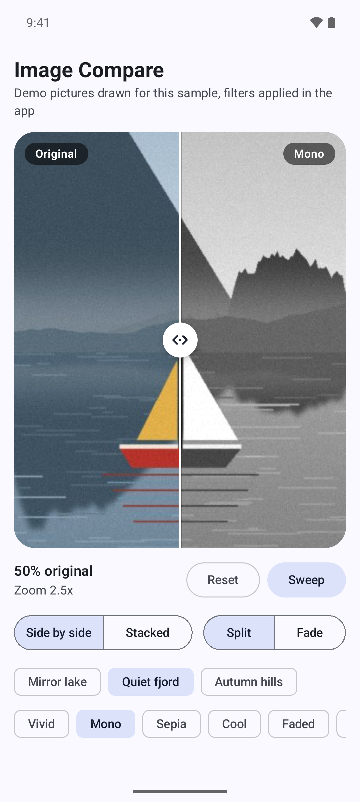
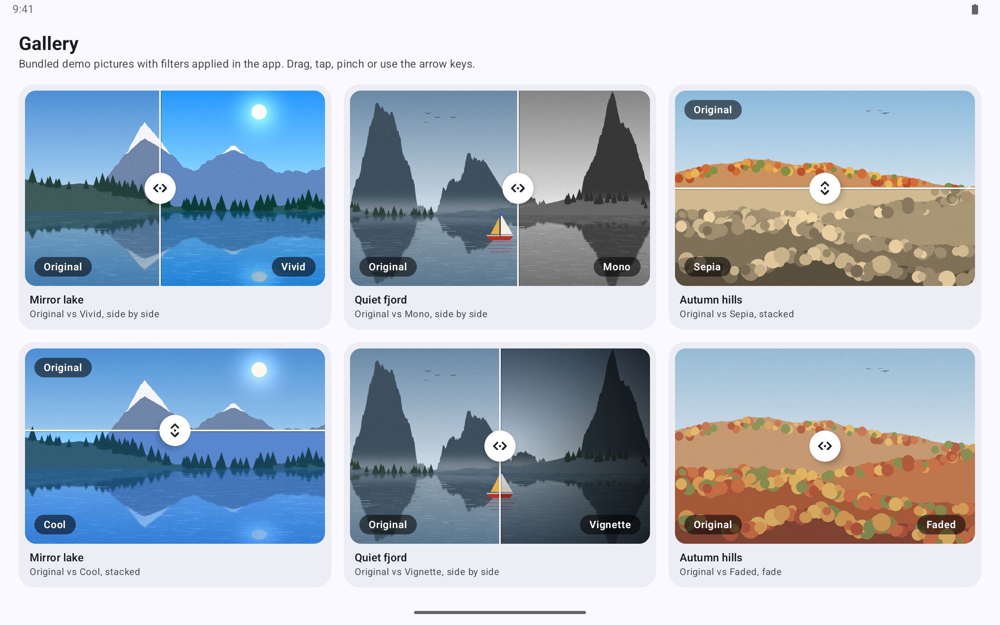

<p align="center">
  
</p>

<p align="center">
  <a href="https://github.com/halilozel1903/compose-image-compare/actions/workflows/ci.yml"></a>
  <a href="https://jitpack.io/#halilozel1903/compose-image-compare"></a>
  
  
  
  
  <a href="LICENSE"></a>
</p>

**compose-image-compare** is a before and after image comparison for Jetpack Compose. Drag the divider (or anywhere along the axis) to reveal more of one image, split side by side or top and bottom, tap to jump, pinch to zoom and pan both images in sync, and label each side. It also has a fade mode, keyboard and D-pad control, TalkBack slider semantics, a saveable state and animations to any position. Pass two painters, or any two composables. The math lives in a small pure Kotlin core with unit tests.

```kotlin
val state = rememberImageCompareState(initialPosition = 0.4f)

ImageCompare(
    before = painterResource(R.drawable.photo),
    after = painterResource(R.drawable.photo),
    afterColorFilter = ColorFilter.colorMatrix(ColorMatrix().apply { setToSaturation(0f) }),
    beforeLabel = "Original",
    afterLabel = "Mono",
    state = state,
    modifier = Modifier.fillMaxWidth().aspectRatio(4f / 5f),
)
```

## Screenshots

Captured from the sample app on Android emulators by CI. The sample applies its filters (color matrices and a vignette) in the app to bundled demo pictures, which are procedural landscapes drawn by [`scripts/demo-photos.py`](scripts/demo-photos.py), not photographs of real places. Each scene opens with the divider and zoom already set.

| Side by side | Stacked | Zoomed in 2.5x |
| :---: | :---: | :---: |
|  |  |  |

**Tablet:** six comparisons side by side in a gallery on a Pixel Tablet in landscape, with side by side and stacked splits, a composable vignette and the fade mode.



## Features

- **Two ways to give it content**: two `Painter`s (with their own `ColorFilter`s, `ContentScale` and `Alignment`), or two composables, so images from Coil or Glide, a map, a chart or a custom drawing all work. Each side gets the full size and is clipped to its side of the divider, so the images always line up.
- **Draggable divider with a handle**: drag the divider, or anywhere along the axis. A drag that goes across the axis is left to a parent, so a list around the comparison still scrolls. The handle is a slot; the default is a white circle with arrows.
- **Horizontal or vertical**: `CompareOrientation.Horizontal` (side by side, mirrored in right-to-left layouts) and `CompareOrientation.Vertical` (top and bottom).
- **Tap to jump**: a tap animates the divider to the tap.
- **Zoom and pan in sync**: pinch to zoom up to `maxZoom`, drag to pan once zoomed, double tap to zoom in at a point and back out. Both images use one transform and the content always covers the viewport.
- **Labels with placement**: a label for each side, at the start, center or end edge across the axis. Labels fade out as the divider reaches them, so a label never sits on the other image.
- **Fade mode**: `CompareMode.Fade` blends the after image over the before image; the handle works as a fader.
- **Animations**: `animateTo(position)`, `sweep()` (to both ends and back), `animateZoomTo(scale, focus)` and `resetZoom()`. A drag cancels a running animation.
- **Keyboard and D-pad**: arrow keys along the axis step the divider, page up and page down take larger steps, home and end go to the ends, `+`, `-` and `0` zoom. The handle shows a focus ring.
- **Accessibility**: the comparison is an adjustable slider for TalkBack, announced as a percentage of the before image, with actions to show the before image, the after image or both halves.
- **Saveable state**: `rememberImageCompareState` keeps the position, the mode and the zoom across rotation and process death. Position, zoom and dragging are observable.
- **Pure Kotlin core** (`compose-image-compare-core`): divider position and hit testing, keyboard steps, label fading, drag intent, zoom and pan clamping. Unit tested.

## Installation

Add JitPack to `settings.gradle.kts`:

```kotlin
dependencyResolutionManagement {
    repositories {
        google()
        mavenCentral()
        maven("https://jitpack.io")
    }
}
```

Then the dependency:

```kotlin
dependencies {
    implementation("com.github.halilozel1903.compose-image-compare:compose-image-compare:1.0.0")

    // Pure Kotlin logic only (divider and zoom math):
    // implementation("com.github.halilozel1903.compose-image-compare:compose-image-compare-core:1.0.0")
}
```

> The build is also set up for Maven Central (`io.github.halilozel1903:compose-image-compare`) via the vanniktech publish plugin.

## Usage

**Two painters**

```kotlin
ImageCompare(
    before = painterResource(R.drawable.before),
    after = painterResource(R.drawable.after),
    beforeLabel = "Before",
    afterLabel = "After",
    modifier = Modifier.fillMaxWidth().aspectRatio(3f / 2f).clip(RoundedCornerShape(16.dp)),
)
```

Give `ImageCompare` a size with its modifier; without one it takes the size of the after content. Use two images with the same aspect ratio (or the same image with a filter), since both are drawn with the same `contentScale`.

**Two composables, top and bottom**

```kotlin
ImageCompare(
    before = { AsyncImage(model = original, contentDescription = null, contentScale = ContentScale.Crop) },
    after = { AsyncImage(model = retouched, contentDescription = null, contentScale = ContentScale.Crop) },
    orientation = CompareOrientation.Vertical,
    beforeLabel = { ImageCompareDefaults.Label("Original") },
    afterLabel = { ImageCompareDefaults.Label("Retouched") },
    labelPlacement = LabelPlacement.End,
    modifier = Modifier.fillMaxWidth().height(420.dp),
)
```

**State and animations**

```kotlin
val state = rememberImageCompareState(initialPosition = 0.5f, maxZoom = 6f)
val scope = rememberCoroutineScope()

ImageCompare(before = before, after = after, state = state, modifier = Modifier.fillMaxSize())

Text("${(state.position * 100).roundToInt()}% before, zoom ${state.scale}")

scope.launch { state.animateTo(0.2f) }                    // or snapTo(0.2f)
scope.launch { state.sweep() }                            // to both ends and back
scope.launch { state.animateZoomTo(2f, focus = Offset(300f, 400f)) }
scope.launch { state.resetZoom() }
state.mode = CompareMode.Fade                             // or CompareMode.Split
```

`position` goes from `0` to `1` from the start of the axis: the before image fills `0..position`. `1` shows only the before image and `0` only the after image, in both modes.

**Customizing**

```kotlin
ImageCompare(
    before = before,
    after = after,
    handle = { ImageCompareDefaults.Handle(CompareOrientation.Horizontal, containerColor = Color.Black, arrowColor = Color.White) },
    dividerColor = Color.Black,
    dividerWidth = 3.dp,
    zoomEnabled = false,           // no pinch, no double tap
    tapToJump = false,
    dragAnywhere = false,          // only the divider is draggable (for comparisons in a horizontal pager)
    keyboardStep = 0.1f,
    contentDescription = "Kitchen before and after the renovation",
)
```

### `ImageCompare` parameters

| Parameter | Default | What it does |
| --- | --- | --- |
| `before`, `after` | | Two `Painter`s, or two `@Composable` slots |
| `state` | `rememberImageCompareState()` | Position, mode and zoom |
| `orientation` | `Horizontal` | Side by side or top and bottom |
| `beforeLabel`, `afterLabel` | `null` | A `String` (painter overload) or a composable |
| `labelPlacement` | `LabelPlacement.Start` | Where labels sit across the axis: `Start`, `Center`, `End` |
| `contentScale`, `alignment` | `Crop`, `Center` | Painter overload: how both painters are drawn |
| `beforeColorFilter`, `afterColorFilter` | `null` | Painter overload: a filter for each side |
| `handle` | `ImageCompareDefaults.Handle(orientation)` | Drawn centered on the divider |
| `dividerColor`, `dividerWidth` | white, `2.dp` | The divider line in split mode |
| `zoomEnabled` | `true` | Pinch to zoom and pan, zoom keys |
| `tapToJump` | `true` | A tap animates the divider to it |
| `doubleTapToZoom` | `zoomEnabled` | Double tap zooms in to 2.5x and back out |
| `dragAnywhere` | `true` | A drag along the axis anywhere moves the divider |
| `keyboardStep` | `0.05f` | Arrow key and D-pad step |
| `contentDescription` | "Before and after comparison" | For accessibility |

### `ImageCompareState`

| Member | What it does |
| --- | --- |
| `position` | Divider position, `0..1` from the start of the axis |
| `mode` | `CompareMode.Split` or `CompareMode.Fade`, settable |
| `scale`, `offset`, `transform`, `isZoomed` | The zoom shared by both images |
| `isDragging`, `isAnimating` | What is moving the divider |
| `snapTo(position)`, `animateTo(position, spec)`, `sweep(spec)` | Move the divider |
| `animateZoomTo(scale, focus, spec)`, `snapZoomTo(scale, focus)`, `resetZoom(animated)` | Change the zoom |
| `minZoom`, `maxZoom` | The zoom range |
| `ImageCompareState.Saver(minZoom, maxZoom)` | Saves position, mode and zoom |

## The core module

`compose-image-compare-core` has no Android or Compose dependency. The composable is built on it, and you can use it in tests or other UI toolkits:

```kotlin
CompareMath.dividerOffset(position = 0.25f, length = 1200f)                // 300
CompareMath.dividerOffset(0.25f, 1200f, reversed = true)                   // 900, right-to-left
CompareMath.positionAt(offset = 900f, length = 1200f)                      // 0.75
CompareMath.step(0.5f, forward = false, step = 0.05f)                      // 0.45
CompareMath.labelAlpha(dividerOffset = 112f, labelLow = 16f, labelHigh = 96f,
    labelOnLowSide = true, fadeDistance = 32f)                             // 0.5
DragIntentDetector.intent(alongAxis = 3f, acrossAxis = 14f, touchSlop = 8f) // Ignore: let the list scroll

val zoomed = ZoomMath.transform(ZoomTransform.Identity, zoomChange = 2f, panX = 0f, panY = 0f,
    focusX = 700f, focusY = 300f, width = 1000f, height = 800f)            // scale 2, the focus stays put
ZoomMath.clamp(ZoomTransform(2f, 900f, -900f), 1000f, 800f)                // offset clamped to (500, -400)
```

| API | What it does |
| --- | --- |
| `CompareMath` | Divider offset and position, drags, keyboard steps, hit testing, fade and label opacity |
| `DragIntentDetector`, `DragIntent` | Whether a drag away from the divider moves it or belongs to a parent |
| `ZoomMath`, `ZoomTransform` | Pinch with a focus point, pan, clamping, double tap target |

## Sample app

The `sample` module compares three bundled demo pictures (Mirror lake, Quiet fjord, Autumn hills) with filters it applies itself: Vivid, Mono, Sepia, Cool and Faded are color matrices passed as `afterColorFilter`, and Vignette is a gradient drawn over the picture in the composable overload. The pictures are procedural landscapes drawn by `scripts/demo-photos.py` (gradients, fractal ridges and simple shapes) and are released under CC0; they are demo content, not photographs. Phones get an editor with every option; wide screens get the gallery.

The sample opens a fixed screen from an intent extra (used by `scripts/screenshots.sh`):

```bash
./gradlew :sample:installDebug
adb shell am start -n io.github.halilozel1903.imagecompare.sample/.MainActivity --es scene zoomed
```

`scene` is one of `horizontal`, `vertical`, `zoomed` or `tablet`. Each logs `SCENE_READY <scene>` once it has settled; CI waits for it, captures the phone scenes on a Pixel 7 and `tablet` on a Pixel Tablet in landscape, checks each capture for the screen's text and fails on blank images.

## Project structure

| Module | What it is |
| --- | --- |
| `image-compare-core` | Pure Kotlin: divider, label, drag intent and zoom math. Published as `compose-image-compare-core` |
| `image-compare` | Compose: `ImageCompare`, `rememberImageCompareState`, `ImageCompareDefaults`. Published as `compose-image-compare` |
| `sample` | An editor for phones and a gallery for tablets, with screenshot scenes |

## Tech stack

Kotlin 2.4 · AGP 9.4 with built-in Kotlin · Gradle 9.6 · Jetpack Compose (BOM 2026.09) · `pointerInput` gestures, `graphicsLayer` zoom and draw-phase clipping · Material 3 in the sample · GitHub Actions with Android emulators

## License

MIT. See [LICENSE](LICENSE). The demo pictures in `sample/src/main/res/drawable-nodpi` are CC0.
